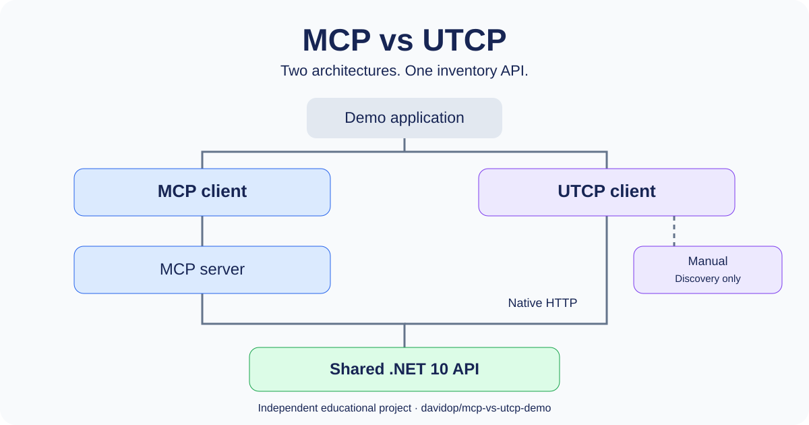

# MCP vs UTCP — Engineering Lab



[](https://github.com/davidop/mcp-vs-utcp-demo/actions/workflows/backend.yml)
[](https://github.com/davidop/mcp-vs-utcp-demo/actions/workflows/protocols.yml)

Independent, evidence-driven comparison / Comparativa independiente basada en evidencias.

- [Architecture and sequence diagrams](docs/architecture/overview.md)
- [Decision and security guide](docs/architecture/decision-guide.md)
- [Specification](specs/001-comparison.md)
- [Branding policy](docs/assets/BRANDING.md)

Hands-on comparison of two tool calling architectures, using the same .NET 10 inventory API. / Comparativa práctica de dos arquitecturas de invocación de herramientas sobre una API común.

**Status:** initial integration code committed; CI verification pending. No performance conclusions yet.

## Run locally
```bash
docker compose up --build -d
python -m pip install -r requirements-mcp.txt -r requirements-utcp.txt
python tests/smoke.py
python src/mcp-client/client.py
```
In another terminal / En otra terminal:
```bash
python -m http.server 8090 --bind 127.0.0.1 --directory manuals
```
Then / Después:
```bash
python src/utcp-client/client.py
```

MCP uses SDK stdio client/server; UTCP discovers a static HTTP manual and invokes the REST endpoint directly. The UTCP manual now declares parameterized product, stock and order operations; runtime parity remains unverified. / El manual UTCP declara operaciones parametrizadas de producto, stock y pedidos; la paridad en ejecución sigue sin verificar. The manual server is for discovery only. No LLM or paid API required.

Single invocation measurements are smoke-test observations, not benchmarks. The warm benchmark alternates protocol order and preserves failures. Cold runs and runtime parity remain pending verification.

## Engineering deliverables

- [Azure APIM architecture decision](docs/architecture/azure-apim.md)
- [Token context study](benchmarks/token-study.md) — offline schema estimates, not billed model usage.
- [Benchmark runner](benchmarks/run.py) and [methodology](benchmarks/README.md)
- [Benchmark CI and artifacts](https://github.com/davidop/mcp-vs-utcp-demo/actions/workflows/benchmark.yml)
- [Evidence dashboard](dashboard/index.html)
- [Slidev deck](slides/slides.md)
- [Release acceptance checklist](docs/release-checklist.md)

The benchmark and Pages workflows are configured, not yet verified. The dashboard imports measured JSON; it does not generate synthetic performance data.

## Official references
- https://modelcontextprotocol.io/
- https://github.com/universal-tool-calling-protocol/python-utcp

See [specification](specs/001-comparison.md). Local synthetic data only.
