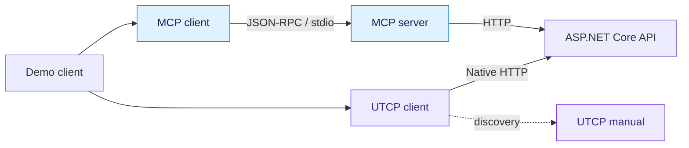
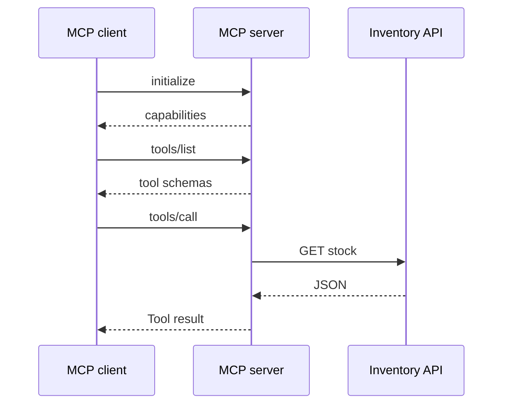
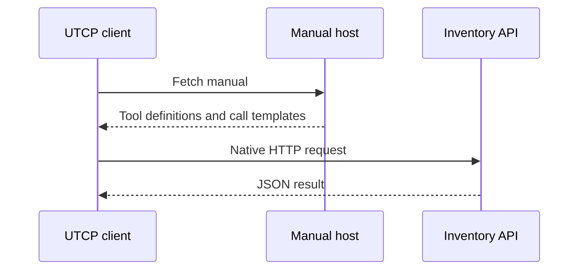

# Architecture / Arquitectura

Both paths use the same synthetic inventory API. The UTCP manual is discovery metadata, not an invocation proxy.

## MCP sequence

## UTCP sequence

MCP servers can implement tools directly; an extra downstream API is not mandatory. UTCP may require gateways for policy enforcement. This diagram describes the lab, not every possible deployment.
