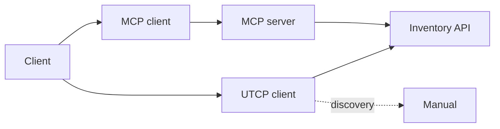

# MCP vs UTCP
Two architectures. One inventory API.

---
# The architectural question
When does a tool execution adapter add value?

---
# Same backend, different invocation paths

---
# Live demonstration
- Start the shared .NET API
- Discover and invoke the stock tool with MCP
- Discover and invoke the stock tool with UTCP
- Compare equivalent business results

---
# Evidence, not assumptions
100 warm calls per protocol configured.
Actual p50, p95 and failure rates must come from CI artifacts.

---
# Architecture decision
MCP when abstraction adds value.
UTCP when native invocation suffices.
Both when justified.
